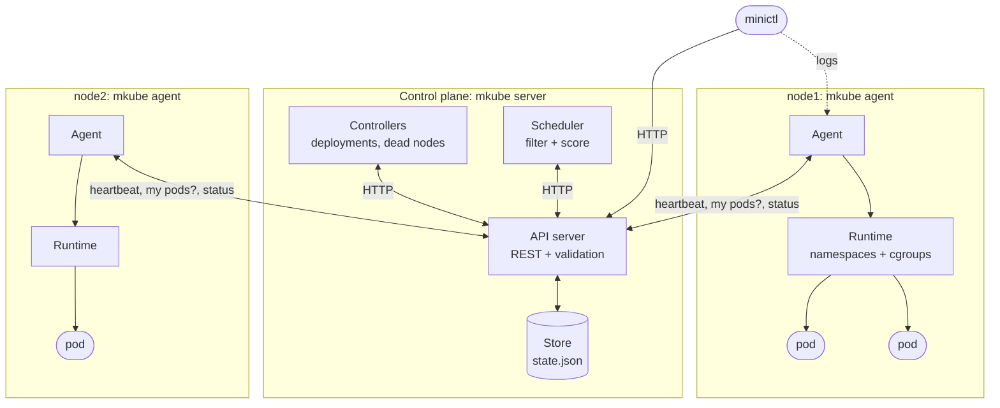

# Mini Kubernetes

[](https://github.com/MITRAKER/mini-kubernetes/actions/workflows/ci.yml)
[](https://github.com/MITRAKER/mini-kubernetes/actions/workflows/codeql.yml)
[](https://goreportcard.com/report/github.com/MITRAKER/mini-kubernetes)
[](go.mod)
[](LICENSE)
[](CONTRIBUTING.md#coding-standard)

A small container orchestrator written from scratch in Go, to learn how Linux
containers and Kubernetes really work. Every layer is built on raw Linux
primitives (namespaces, cgroups, `pivot_root`), with no Docker or containerd
underneath, and the only third-party dependency is a YAML parser.

> **Learning notes:** [LEARNING.md](LEARNING.md) explains every milestone:
> what was built, why, the concepts behind it, exercises and interview
> questions.

## What it can do

- **Run isolated containers** with their own hostname, process tree, filesystem
  and network, and enforce **CPU, memory and process limits** with cgroups
  (v1 and v2).
- **Schedule pods** across nodes by free CPU and memory, spreading the load.
- **Keep Deployments at their replica count**, scale them up and down, and do
  **zero-downtime rolling updates**.
- **Heal itself:** when a node stops sending heartbeats, its pods are recreated
  on healthy nodes.
- **Restart crashed containers** with exponential backoff (`CrashLoopBackOff`)
  and report `OOMKilled` when a container exceeds its memory limit.
- **`minictl`**, a small `kubectl`: `apply -f`, `get`, `logs`, `scale`, `delete`.

## Architecture



Every component talks **only to the API server**. Each one runs a
reconciliation loop: read the current state, compare it with the desired
state, take one step to close the gap. Nobody tells the scheduler that a node
died; it just stops seeing that node as Ready.

| Mini Kubernetes | Real Kubernetes |
|---|---|
| `internal/runtime` | runc |
| `mkube agent` | kubelet |
| `internal/apiserver` + store | kube-apiserver + etcd |
| `internal/scheduler` | kube-scheduler |
| `internal/controller` | kube-controller-manager |
| `minictl` | kubectl |

## Demo

Needs Linux, Go 1.23+ and root. One command starts a 3-node cluster on your
machine and walks through scheduling, a node failure, scaling and an OOM kill:

```bash
sudo make demo
```

Output (shortened):

```text
=== Deploying 3 replicas of hello ===
$ minictl get pods
NAME          STATUS    RESTARTS   NODE    AGE
hello-dbjf7   Running   0          node1   3s
hello-n4rpt   Running   0          node2   3s
hello-x2g8h   Running   0          node3   3s

=== Killing node3's agent (simulating a machine failure) ===
$ minictl get nodes
NAME    STATUS     CPU     MEMORY   LAST HEARTBEAT
node1   Ready      1000m   512Mi    1s ago
node2   Ready      1000m   512Mi    1s ago
node3   NotReady   1000m   512Mi    15s ago
$ minictl get pods
NAME          STATUS    RESTARTS   NODE    AGE
hello-dbjf7   Running   0          node1   17s
hello-kkgjg   Running   0          node1   4s      <- replaced automatically
hello-n4rpt   Running   0          node2   17s

=== Memory limits: a pod that uses too much memory ===
memory-hog    OOMKilled   0          node2   4s
```

### Running it by hand

```bash
make build
sudo ./scripts/make-rootfs.sh rootfs          # Alpine minirootfs, ~3 MB
sudo mkdir -p /var/lib/mkube/images
sudo ln -s "$PWD/rootfs" /var/lib/mkube/images/alpine

sudo ./bin/mkube server &                     # control plane on :6443
sudo ./bin/mkube agent -name node1 &          # a node

./bin/minictl apply -f examples/hello.yaml
./bin/minictl get pods
./bin/minictl logs <pod-name>
```

Or run a single container with no cluster at all:

```bash
sudo ./bin/mkube run -name demo -rootfs rootfs -memory 64Mi -cpu 500m -pids 50 -net -- sh
```

### Manifests

```yaml
kind: Deployment
name: hello
replicas: 3
template:
  image: alpine                 # a directory in the node's image folder
  command: ["sh", "-c", "echo hello from $(hostname); sleep 3600"]
  limits: {cpu: 100m, memory: 32Mi}
  restartPolicy: Always         # Always | OnFailure | Never
```

More in [`examples/`](examples).

## Tests and quality

```bash
make check                    # lint (JPL rules), unit tests, tidy modules
sudo make test-integration    # real containers, including a full cluster
sudo make cover               # coverage report, fails below 65%
make vuln                     # known vulnerabilities in dependencies
```

Every pull request runs: **golangci-lint** with 19 linters configured for the
NASA/JPL "Power of Ten" rules (zero findings allowed), **race-detector unit
tests**, **integration tests as root** with real namespaces and cgroups,
a **coverage gate**, **govulncheck** and **CodeQL**. Dependabot keeps
dependencies current, pre-commit hooks run the same checks locally, and
pushing a `v*` tag publishes a release with Linux binaries.
See [CONTRIBUTING.md](CONTRIBUTING.md) for the coding standard.

`test/e2e` runs a whole cluster in one test process (API server, scheduler,
controllers and two agents over real HTTP) and checks scheduling, scaling,
node failure, rolling updates and garbage collection, once with fake
containers and once with real ones. CI runs both on every push.

## Layout

```text
cmd/mkube/            runtime, node agent and control plane binary
cmd/minictl/          the kubectl-like client
internal/runtime/     namespaces, cgroups, pivot_root
internal/agent/       node agent (like the kubelet)
internal/api/         Node, Pod and Deployment types
internal/apiserver/   REST API and the state store (like etcd)
internal/scheduler/   picks a node for each pod
internal/controller/  Deployment and node-failure control loops
internal/client/      API server HTTP client
internal/manifest/    YAML manifests
test/e2e/             a whole cluster inside one test
examples/             ready-to-apply manifests
scripts/              rootfs builder, demo, coverage gate
.github/              CI, CodeQL, release, Dependabot, templates
LEARNING.md           how and why, chapter by chapter
```

## Limitations

This is a learning project, not a production system. Notably: no container
networking between nodes (pods use the host network or an isolated loopback),
no authentication on the API, no image pulling (images are directories on
each node), and all components poll instead of using watches.
[LEARNING.md](LEARNING.md) suggests how to add each of these as an exercise.

## License

[MIT](LICENSE)
